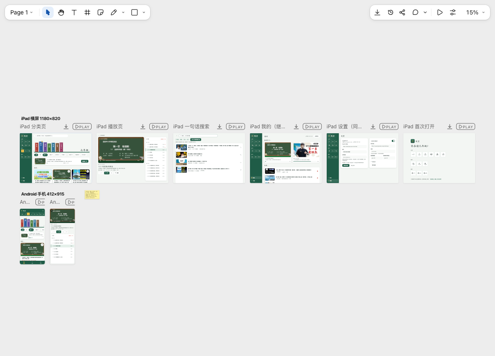

# 随堂

按年级和学科整理 B 站学习视频，在应用里直接播放。

[](LICENSE)


从 B 站搜索中小学学习视频，按「年级 → 学科 → 册次」归类；大模型再判断一遍哪套课讲得好、适合什么程度，给出一句批注；课程按课本章节分成一节一节，支持倍速、续播、记录看到哪里。学习进度和收藏用你自己的 WebDAV 网盘在多台设备之间同步（做法和 Montage 一样）。

三端都已做出：网页原型、iPad 版（SwiftUI）、Android 版（Jetpack Compose）。

> 本项目与 B 站没有隶属或官方关联。B 站的接口没有公开文档，服务条款也限制第三方客户端，接口随时可能变化；课程大多是搬运的，版权归属于原 UP 主。自己用、家用没问题，要上架应用商店请先评估法律风险。内容版权的详细说明见 [THIRD_PARTY_NOTICES.md](THIRD_PARTY_NOTICES.md)。

## 快速上手

```bash
pip3 install anthropic          # 只有大模型整理需要，不装也能用
cp config.example.json config.json   # 想用大模型整理再填密钥
python3 server.py
```

浏览器打开 http://localhost:5188 。

没有配置密钥时只用标题规则分类，其他功能不受影响。

## 项目结构

整理好的分类缓存在 `cache/` 目录，24 小时内重开不会重新请求 B 站。大模型整理的模型、密钥、接口地址等写在配置文件里，见下文「大模型配置」。除大模型整理需要 `anthropic` 包，其余部分只用 Python 自带的库。

| 文件 | 内容 |
| --- | --- |
| `classify.py` | 年级、学科、册次目录表；搜索词生成；从标题认年级、学科、版本、册次；过滤和排序规则 |
| `ai.py` | 读取大模型配置；调 Claude 做第二遍整理（是否对口、内容类型、难度、简介、质量分、批注）和一句话搜索的解析；`python3 ai.py --check` 自检 |
| `config.example.json` | 大模型配置示例，复制成 `config.json` 后修改 |
| `server.py` | 调 B 站搜索、视频详情、播放地址接口；后台运行大模型整理；把视频流转给页面；转交多端同步请求；页面静态文件 |
| `sync.py` | 网页原型的多端同步：读写 WebDAV 网盘、合并各设备的文件；`python3 sync.py` 跑共用合并用例 |
| `web/` | 页面：首次选年级、年级（田字格）、学科（书脊）、册次/版本/内容类型筛选、推荐、课程列表、播放页、搜索、我的（继续学习、收藏）、设置（多端同步） |
| `designs/brand/` | 标志和设计规范：颜色、字体、组件数值，另有三端的图标源文件 |
| `designs/learning-videos/` | 设计稿画布（claude-design 格式）：iPad 6 张、Android 2 张，两轮回归后的定稿，iPad 和 Android 都按它实现 |
| `ios/` | iPad 版（SwiftUI），见下文「iPad 版和 Android 版」 |
| `android/` | Android 版（Kotlin + Jetpack Compose） |
| `docs/sync-format.md`、`docs/sync-cases.json` | 多端同步格式，以及网页、iPad、Android 共用的合并测试用例 |
| `CHANGELOG.md` | 每个版本的变更明细 |
| `THIRD_PARTY_NOTICES.md` | 参考过的项目、随仓库分发的第三方内容和版权归属 |
| `.github/workflows/ci.yml` | 每次推送跑：入库内容检查（拒绝密钥文件、本机路径、公司信息）、同步合并用例、Android 单元测试 |

## 名字和界面

应用叫「随堂」。界面按一间教室来设计：左侧年级栏是一块黑板，右侧内容铺在作业本的纸面上；学科做成搁板上的一排书脊，当前学科的书脊顶端夹一条粉笔黄书签；当前年级在黑板上的田字格里填粉笔黄；看完的节用红笔打勾。整套界面只有黑板绿 `#1F5C47` 和红笔红 `#C23B2B` 两种强色，其余是纸、墨和浅绿。



<sub>设计稿画布全览（iPad 6 张、Android 2 张），三端都按它实现，用 claude-design 打开可交互。</sub>

三端（网页、iPad、Android）的颜色值、圆角、线宽相同，尺寸按屏幕调整：网页和 iPad 的年级栏宽 200，Android 用顶栏加底部导航。颜色、字体、标志和每个组件的数值写在 `designs/brand/README.md`，代码里分别在 `web/app.css`、`ios/BiliStudy/UI/Theme.swift`、`android/.../ui/Theme.kt`，改的时候三处一起改。图标源文件在 `designs/brand/`。

## 同类产品

| 产品 | 做法 | 和本项目的差别 |
| --- | --- | --- |
| B 站「校园学习」分区 | 只有分区和标签 | 没有年级、学科、册次目录，搜索结果混杂 |
| [自学基地](https://rank2.3ceng.cn/) | B 站老师排行榜，可按学科和学段（小学/初中/高中）筛选 | 只整理到 UP 主，不到具体课程和册次，点开跳转 B 站 |
| [国家中小学智慧教育平台](https://basic.smartedu.cn/) | 官方课程，按学段 → 年级 → 学科 → 版本 → 册次组织 | 只有自己录制的课。本项目的目录层级照搬它。B 站上不少成套课程就是从这里搬运的，原型里排在前面的人教版七上数学，片头就是「国家中小学课程资源」 |
| 知乎、豆瓣上的人工清单（[示例 1](https://zhuanlan.zhihu.com/p/18679763613)、[示例 2](https://www.douban.com/note/809497538/)） | 按科目和年级列出 B 站合集链接 | 多是 2020–2022 年写的，大量链接失效；没有播放功能 |
| 洋葱学园、乐乐课堂、作业帮 | 自有课程，按年级、学科、章节组织 | 不用 B 站内容 |

没有找到「按年级和学科整理 B 站视频，并在应用里播放」的产品。

## 目录结构

学段 → 年级 → 学科 → 册次 → 课程 → 分节（按课本章节分组）

| 年级 | 学科 | 册次 |
| --- | --- | --- |
| 一、二年级 | 语文、数学、道德与法治、科学 | 上册、下册 |
| 三至六年级 | 语文、数学、英语、科学、道德与法治 | 上册、下册 |
| 七年级 | 语文、数学、英语、生物、地理、历史、道德与法治 | 上册、下册 |
| 八年级 | 七年级的科目加物理 | 上册、下册 |
| 九年级 | 语文、数学、英语、物理、化学、历史、道德与法治 | 上册、下册（物理为全一册） |
| 高一 | 语文、数学、英语、物理、化学、生物、历史、地理、政治 | 必修一、必修二 |
| 高二 | 同高一 | 选择性必修一、选择性必修二 |
| 高三 | 同高一 | 一轮复习、二轮复习 |

课本版本（人教版、北师大版、苏教版等）做成筛选项，不做成一级目录：实测五个分类里，标题写了版本的只占 9%–94%，差别很大（高三一轮复习 34 条里只有 3 条写了版本）。用户选过的版本按学科记住。语文、历史、道德与法治全国统一用统编版，标题里写「人教版」的也归到统编版。

目录表在 `classify.py` 的 `subjects_for` 和 `volumes_for` 两个函数里，页面从 `/api/taxonomy` 读取，改年级或学科只改这一处。

## 视频怎么找、怎么归类

搜索和视频详情的接入方式参考 Montage 项目 `library/vod` 里的 `BilibiliSearch` 和 `BilibiliVideoClient`：先从 `x/frontend/finger/spi` 取访客 buvid3 Cookie，再调 `x/web-interface/search/type` 搜索。不带这个 Cookie 时，B 站约三分之一的请求会返回 412。

每个分类按这几步处理：

1. 生成两个搜索词。例如七年级数学上册搜「七年级数学上册」「初一数学上册」；高一物理必修一搜「高中物理必修一」「高一物理必修一」；高三搜「高考数学一轮复习」「高三数学一轮复习」。
2. 搜索时带 `tids=208`，只要校园学习分区。不带这个参数时，「七年级数学」的结果里会混进娱乐区的搬运号。
3. 从标题认出年级（七年级、初一、七上、高二、1-6年级）、学科、册次（上册、必修一、上下册）、版本、集数（全189集、170讲、100P）。
4. 按下表过滤。标题里写明的年级、学科、册次和当前分类不一致就不收；标题没写的不排除，只是排序靠后。

| 过滤原因 | 判断方法 |
| --- | --- |
| 无法播放 | 没有 BV 号（B 站付费课堂） |
| 付费或充电专属 | 搜索结果里 `is_pay`、`is_charge_video`、`badgepay` 任一为真 |
| 账号已注销 | 作者名是「账号已注销」，视频随时可能失效 |
| 短于 3 分钟 | 多是短视频片段 |
| 年级不符 | 标题写了别的年级。「小升初」「中考」「高考」只在标题没写具体年级时才用来判断，避免「七年级……直击中考」被归进九年级 |
| 学科不符 | 标题写了别的学科 |
| 册次不符 | 标题写了别的册次 |

5. 排序分数：播放量和收藏量（取对数，收藏权重 1.5 倍）；收藏数超过播放数 2% 加分；标题写明当前年级、册次加分；一至九年级在 2024 年 7 月后发布或标题写「新教材」的加分（义务教育从 2024 年秋季开始逐年换新教材）；成套课程加分。
6. 列表分成「整套课程」（4 集以上或总时长超过 1 小时）和「单个讲解」两部分。
7. 打开课程后，读分集标题里的「1.2.1」「第一单元」「Unit 3」，把各节按章分组；能认出章节的分集不到一半时不分组。

2026-11-12 实测五个分类：

| 分类 | 搜到 | 收录 | 过滤 | 整套课程 | 过滤原因 |
| --- | --- | --- | --- | --- | --- |
| 七年级数学上册 | 44 | 42 | 2 | 40 | 短于 3 分钟 1，账号已注销 1 |
| 三年级语文上册 | 41 | 34 | 7 | 24 | 年级不符 5（一年级、五年级的课），账号已注销 1，学科不符 1（三年级数学） |
| 高一物理必修一 | 35 | 34 | 1 | 31 | 年级不符 1（高三一轮复习） |
| 八年级英语下册 | 42 | 36 | 6 | 31 | 年级不符 3（七年级、九年级），册次不符 2（八年级上册），短于 3 分钟 1 |
| 高三数学一轮复习 | 35 | 34 | 1 | 33 | 年级不符 1 |

每个分类页底部「已过滤 N 条」可以展开看过滤原因、例子和用到的搜索词，用来检查规则。

## 大模型整理

标题规则能可靠地认出「七年级」「上册」「人教版」这类写明的信息，但判断不了「这套课讲得好不好」「是同步课还是复习课」「是不是借课程引流卖资料」。这部分交给 Claude。

### 分工

| 步骤 | 谁来做 | 做什么 |
| --- | --- | --- |
| 召回 | 规则 | 每个分类两个搜索词，只要校园学习分区 |
| 明显过滤 | 规则 | 付费、已注销账号、短于 3 分钟、标题写了别的年级/学科/册次 |
| 判断 | 大模型 | 每条视频给出：是否对口（对口 / 相关 / 不对口）、内容类型（同步课、专题讲解、习题讲解、复习冲刺、预习衔接、朗读听读、其他）、难度（基础 / 中等 / 拔高）、标题里看不出时补版本、一句话简介（28 字以内）、1–5 分质量分、给家长看的一句批注 |
| 排序和推荐 | 规则 | 列表：规则分数加上（质量分 − 3）× 1.5，「相关」减 2 分；「不对口」移到已过滤。推荐：从对口且 4 分以上的视频里，先按质量分、再按是否新教材、最后按规则分数排序，取前 3 条；同一套课被多个账号搬运时（集数相同或标题高度相似）只推荐一条 |

大模型的输入是标题、UP 主、时长、集数、播放和收藏数、发布年月、标签、简介。提示词里写明了质量的加分项（成套完整、按课本章节、真人讲解、收藏率高、2024 年 7 月后的新教材）和减分项（堆砌关键词、引流卖资料、只翻课件、教材已换版的旧课、零散片段），在 `ai.py` 的 `ORGANIZE_SYSTEM` 里，可以直接改。

视频标题和简介是别人写的，可能夹带「忽略以上要求」之类的文字。提示词要求把它们只当数据，且输出被 JSON Schema 限定了字段和取值，最坏情况是单条视频被判错，影响不到其他视频。

### 页面上的变化

- 首次打开先问「你在读几年级？」，之后每次直接进这个年级上次看的学科和册次。
- 分类页先显示规则结果和「大模型整理中」，后台每 10 条视频一批、4 批并行发给大模型，完成后页面自动换成整理后的结果：最上面是「推荐」（带红色批注），每条课程下面多一行简介，可以按内容类型筛选。
- 搜索框可以直接说一句话，例如「我初二，浮力听不懂」。大模型把它解析成年级、学科、册次、知识点和 B 站搜索词（这里是「八年级物理下册 浮力」），结果里年级学科对得上的排前面，并给出「打开八年级物理下册」的直达入口。话里没说年级时按用户选的年级理解。
- 没有密钥、接口出错或超时时，自动退回规则结果；分类页底部的「整理说明」会写明原因。

### 调用方式

- 用官方 `anthropic` SDK 的 Messages API。让模型返回 JSON 有三种方式，由配置项 `json_mode` 决定：官方 Claude 接口用结构化输出（`output_config.format` 设为 JSON Schema，接口保证返回合法）；兼容 Anthropic 接口的网关大多不支持结构化输出，改为让模型调用一个参数就是结果的工具；连工具调用都不支持时，在提示词里要求只输出 JSON。无论哪种方式，拿到结果后都会再按 Schema 校验一遍，缺字段或取值不合法时填保守的默认值。
- `effort` 默认 `low`：分类类任务不需要深度推理，返回更快。
- 在官方接口上使用 Opus 5、Sonnet 5.5、Fable 5 系列模型时，带上服务端回退（`fallbacks: "default"`）：如果安全分类器误拒了请求，服务端自动换模型重跑，不用自己写重试。
- 结果按「提示词版本 + 模型 + 分类 + 这批视频的 BV 号」缓存 24 小时，同一批视频不会重复整理，换了模型会重新整理；一句话搜索的解析结果按「提示词版本 + 模型 + 年级 + 月份 + 原话」缓存 7 天。改了 `ai.py` 里的提示词，把对应的 `ORGANIZE_PROMPT_VERSION` 或 `INTENT_PROMPT_VERSION` 加一，旧缓存就不再使用。
- 一句话搜索会把当前学期告诉模型：话里看不出册次时，9 月到次年 1 月按上册理解，2 月到 7 月按下册理解。

### 大模型配置

所有大模型相关的设置都在配置文件里，不写在代码中：

```bash
cp config.example.json config.json
```

默认读取 `BiliStudy/config.json`。想把配置放在项目外（例如密钥不想放在项目目录里），启动前用环境变量 `BILISTUDY_CONFIG` 指定路径。没有配置文件时全部使用默认值。

配置文件改动后，下一次请求自动生效，不用重启服务。写错时（拼错配置项名、类型不对、取值不在范围内、JSON 格式错误），大模型整理会暂停，服务日志和分类页底部的「整理说明」会写出哪一项错了；页面继续用标题规则分类。

| 配置项 | 默认值 | 说明 |
| --- | --- | --- |
| `enabled` | `true` | 设为 `false` 时只用标题规则 |
| `api_key` | `""` | Anthropic API 密钥；留空时读环境变量 `ANTHROPIC_API_KEY` |
| `auth_token` | `""` | 网关要求 Bearer 令牌时填这里；留空时读环境变量 `ANTHROPIC_AUTH_TOKEN` |
| `base_url` | `""` | 接口地址；留空时读环境变量 `ANTHROPIC_BASE_URL`，再没有就用官方地址。可填兼容 Anthropic Messages 接口的网关 |
| `organize_model` | `"claude-opus-5-5"` | 分类整理用的模型 |
| `intent_model` | `"claude-opus-5-5"` | 一句话搜索解析用的模型，可以和整理用不同的模型 |
| `effort` | `"low"` | `low` / `medium` / `high` / `xhigh` / `max`；填 `""` 表示请求里不带这个参数，给不支持它的模型用 |
| `organize_max_tokens` | `8000` | 每次整理请求的输出上限（256–64000）；提示「输出被截断」时调大，或调小 `batch_size` |
| `intent_max_tokens` | `2000` | 每次搜索解析的输出上限（256–16000） |
| `batch_size` | `10` | 每次请求整理几条视频（1–50），越小单次返回越快、请求次数越多 |
| `concurrency` | `4` | 同时发出几个请求（1–16） |
| `timeout_seconds` | `120` | 单次请求超时（10–600 秒） |
| `max_retries` | `2` | 限流、服务端错误、网络错误时 SDK 自动重试的次数（0–10） |
| `fallbacks` | `"auto"` | `auto`：在官方接口上使用 Opus 5、Sonnet 5.5、Fable 5 系列模型时启用服务端回退；`off`：不启用。走网关时 `auto` 也不会启用，因为网关不一定认这个参数 |
| `json_mode` | `"auto"` | 怎样让模型返回 JSON。`schema`：结构化输出，只有官方 Claude 接口支持；`tool`：让模型调用一个参数就是结果的工具；`prompt`：提示词要求只输出 JSON 再从文字里取出。`auto`：官方接口用 `schema`，其他地址用 `tool` |

优先级：配置文件里写了的值 > 对应的环境变量 > 默认值。

#### 示例：智谱 GLM

智谱提供兼容 Anthropic Messages 接口的地址（[智谱文档](https://docs.bigmodel.cn/cn/guide/develop/claude)），按下面写 `config.json` 即可，其余项用默认值：

```json
{
  "ai": {
    "auth_token": "智谱的 API Key",
    "base_url": "https://open.bigmodel.cn/api/anthropic",
    "organize_model": "glm-5.3",
    "intent_model": "glm-5.3",
    "effort": "low",
    "fallbacks": "off"
  }
}
```

2026-11-12 实测这个接口：

- 用 `auth_token`（Bearer 方式）鉴权可以正常调用 `glm-5.3`。智谱文档说订阅过 GLM Coding Plan 的账号暂时只能走 OpenAI 协议，遇到鉴权或权限错误时先查这一点。
- 结构化输出（`output_config.format`）不报错，但会被忽略，模型照常回一段 Markdown；工具调用（强制调用指定工具）可以正常返回 JSON，所以 `json_mode` 用默认的 `auto` 即可（走网关时自动用 `tool`）。
- `effort: "low"` 会生效：不再返回思考过程，一个小请求从约 7 秒降到约 4 秒。
- 整理七年级数学上册 44 条用时 22 秒，三年级语文上册 35 条用时 15 秒（每批 10 条、4 批并行）；一句话搜索每句 5 到 8 秒。

`config.json` 里如果写了密钥，不要提交到代码仓库，也不要发给别人。

改完配置后可以自检，它会读取配置、打印生效的模型和接口地址（不打印密钥），并各发一次很小的真实请求（搜索解析一次、整理一条视频），报告耗时和返回结果：

```bash
python3 ai.py --check
```

### 费用估算

按每个分类约 40 条视频、4 次请求、合计约 1 万输入 token 和 6 千输出 token 估算（未实测，真实用量以接口返回的 `usage` 为准）。全部 153 个分类（12 个年级 × 学科 × 册次）整理一遍：

| 模型 | 每个分类 | 全部 153 个分类 |
| --- | --- | --- |
| `claude-opus-5-5`（默认） | 约 0.16 美元 | 约 25 美元 |
| `claude-haiku-5-5` | 约 0.004 美元 | 约 0.6 美元 |

自己家用、只看一个年级时，Opus 的费用也很低；要每天把全部分类刷新一遍时，建议先用一批分类对比两个模型的判断，再决定用哪个。

### 验证情况

- 已验证：没有密钥时退回规则结果；用本地假接口确认了 SDK 发出的请求和返回解析正确，配置文件各项按配置发出，改文件后不重启即生效，写错时的提示，整理失败后改配置会立即重试。
- 已用智谱 `glm-5.3` 实测（2026-11-12）：七年级数学上册、三年级语文上册两个分类，以及「我初二，浮力听不懂」「孩子三年级，古诗总是背不下来」「高一函数单调性怎么判断」三句话。判断结果合理，例如把「需互动领取，引流明显」「PPT 课件翻页讲解，以卖课件引流」「标题堆砌关键词」的视频打了低分，识别出朗读类和不对口的视频；三句话都解析到了正确的年级、学科和知识点。
- 发现并已修正：同一套课被多个账号搬运时推荐重复；播放量很高的旧版课程排进推荐第一；话里没说册次时被猜成下册（现在按当前学期）。
- 已知情况：同一批视频两次整理的打分会有出入，推荐结果不完全固定；七年级数学 44 条里有 1 条模型漏判，这条按规则结果显示。
- 未验证：真实调用 Claude 的效果、耗时和费用；智谱接口的费用（以智谱控制台为准）。

## 播放

B 站官方嵌入播放器（`player.bilibili.com/player.html`）嵌在 localhost 页面里会显示「非常抱歉，本视频可能由于以下原因导致无法正常播放」，单独打开同一地址则正常，说明它限制了嵌入来源。原型因此改用和 Montage 安卓端相同的做法：

- 调 `x/player/playurl`（`fnval=1`）拿 MP4 地址。
- B 站视频服务器要求请求带 B 站的 Referer，浏览器做不到，所以由 `server.py` 带上 Referer 转发视频流，支持拖动进度。
- 页面用自己的播放器，因此能记住每一节看到哪里、看完 90% 打勾、播完自动下一节、倍速（1、1.25、1.5、2 倍）。

**清晰度限制**：不登录时 B 站只给 360P。MP4 和 DASH 两种格式都试过，结果一样。黑板板书和课件在 360P 下能看清大字，小字会糊。要 720P 或 1080P，需要用户用自己的 B 站账号扫码登录。这一点需要你决定是否做。

安卓正式版不需要转发视频流：ExoPlayer 可以直接带 Referer 请求，Montage 的 `BilibiliPlayerActivity` 已经这样做，也处理了一个视频分多段 MP4 的情况。

## iPad 版和 Android 版

两个版本都在 App 里直接调 B 站接口和大模型接口，不需要电脑上的 `server.py`。分类规则、提示词、推荐规则和原型一致：规则从 `classify.py` 逐条移植，提示词由脚本从 `ai.py` 生成（`Prompts.swift`、`Prompts.kt`，文件头写了生成方法），改的时候三处一起改。

| | iPad | Android |
| --- | --- | --- |
| 界面 | SwiftUI，iPadOS 17 起，横竖屏都支持 | Jetpack Compose，Android 8.0 起，手机布局 |
| 播放 | AVPlayer，请求带 B 站要求的 Referer 和桌面 UA | Media3 ExoPlayer，同上（和 Montage 的做法一样） |
| 大模型 | 直接发 HTTP 请求（Swift 没有官方 SDK） | 官方 Java SDK `com.anthropic:anthropic-java` 3.3.0 |
| 密钥和网盘密码 | 系统钥匙串 | Android Keystore 加密存储 |
| 学习数据 | Application Support 下的 `library.json` | 应用私有目录下的 `library.json` |
| 楷体 | 向系统按需下载苹果提供的「楷体-简」 | 系统不带楷体，用系统衬线字体 |

大模型的接口地址、密钥、两个任务的模型、鉴权方式、思考强度、取结果方式、API 版本都在 App 的「设置」里填，对应原型 `config.json` 的同名项。

### 编译和运行

iPad 版（工程由 XcodeGen 按 `ios/project.yml` 生成）：

```bash
cd ios && xcodegen generate && open BiliStudy.xcodeproj
```

Android 版：

```bash
cd android && ./gradlew :app:assembleDebug
```

两个版本的调试包都支持用启动参数直接选年级、打开某个页面、填大模型设置、登录网盘，方便在不手动点屏幕的情况下验证（只在调试包里生效，正式包忽略）：iPad 用环境变量 `BILISTUDY_DEBUG_GRADE`、`BILISTUDY_DEBUG_ROUTE`、`BILISTUDY_AI_TOKEN` 等，见 `ios/BiliStudy/App/AppModel.swift`；Android 用 `am start` 的参数 `grade`、`route`、`ai_token`、`dav` 等，见 `android/.../App.kt`。用 `adb shell am start` 传带 `|` 的参数时要再加一层单引号，否则会被手机上的 shell 当成管道符。

### 多端同步

格式见 `docs/sync-format.md`：做法照搬 Montage，每台设备只写网盘 `bilistudy/` 文件夹里自己的文件，读别人的文件后在本机按时间合并，删除留墓碑。网页原型、iPad 和 Android 用同一套格式，`docs/sync-cases.json` 里的合并用例三边都跑（`python3 sync.py`、iPad 和 Android 的单元测试）。

同步的内容：收藏、最近在学、每一节看到哪里、看完的节，以及选过的年级、学科、册次和课本版本。同步时机：打开或切回页面（最多每分钟一次）、收藏变化后约 3 秒、退出播放页、手动点「立即同步」。

网页原型的做法：

- 坚果云等网盘不给浏览器跨域访问，页面不能直接读写网盘。和 Montage 网页版一样，由本机的 `server.py` 转交：页面把本机数据和网盘账号 POST 给 `/api/sync`，`sync.py` 读别的设备的文件、合并、上传自己的文件，再把合并结果还给页面。
- 账号放在请求体里，不进网址和服务日志；`server.py` 不保存账号，只缓存别的设备文件的内容（按 ETag 判断是否变了）。
- 网页在「设置」里填 WebDAV 地址、账号和应用密码，保存前先实际连一次网盘，密码不对直接提示。设备名按浏览器和系统取，例如「网页 Chrome（Mac）」。
- 本机数据存在浏览器的 localStorage 里。旧版原型分开存的选择、最近在学、看完的节和播放位置，第一次打开新版时自动转成同步格式。
- 同步回来时，「我的」和设置页整页刷新；书架和搜索页只原地更新书签和「继续学习」卡片，不打断浏览；播放页只更新目录里的勾，不打断播放。

### 验证情况（2026-11-12、11-13）

- 单元测试：iPad 9 个、Android 9 个，全部通过（分类规则样例和原型一致，同步合并跑共用用例）。
- iPad：iPad Pro 11 英寸模拟器（iOS 26）。首次选年级、七年级数学分类页（规则结果先出，智谱 glm-5.3 整理后出现推荐、简介、批注和类型筛选）、横屏布局、播放（360P，进度每 5 秒记录）、一句话搜索、我的、设置都截图确认。
- Android：三星 SM-A536B（Android 16，系统字号 1.15 倍）。分类页、大模型整理、播放、我的、设置截图确认；按 1.15 倍字号修正了书脊文字溢出和推荐批注截断。
- 同步：在电脑上起了一个测试用 WebDAV 服务，放入一份模拟设备的文件。iPad 合并了对方的收藏、进度和看完的节，并上传自己的文件；在模拟设备上取消收藏后，iPad 同步时跟着取消并留下墓碑；打开课程从对方的进度（第 3 节第 252 秒）接着播。Android 真机经 `adb reverse` 连同一个服务，拿到了 iPad 的收藏、进度和学科选择，并上传了自己的文件。
- 网页同步：用 iPad 模拟器和 Android 手机实际写出的三份文件起测试网盘。网页登录后拿到了它们的收藏、继续学习和看完的节；网页收藏、取消收藏、播放进度和最近在学（带年级、学科、册次）都写进了网页自己的文件，按其他设备的方式合并能得到同样结果；改动 iPad 和 Android 的文件后点「立即同步」，网页跟着更新；播放页从 iPad 的进度（第 3 节第 252 秒）接着播；密码错误、网盘连不上、旧数据迁移、停止同步、手机宽度排版都检查过。JS 的合并函数也跑了共用用例。
- 界面改版（2026-11-13）：网页在浏览器里逐页检查；iPad 在 iPad Pro 11 英寸模拟器里检查；Android 在三星 SM-A536B 上用 `adb shell uiautomator dump` 逐个读取界面元素，核对分类、我的、设置、搜索、播放五页的黑板页头、田字格年级、书脊和书签、筛选胶囊、继续学习卡、目录卡等结构。设计稿画布 8 张也在画布服务里核对过：尺寸与画布配置一致，没有元素溢出，封面图全部加载，无脚本报错。
- 真实坚果云账号没有测试。

### 已知限制

- 不登录 B 站只能拿到 360P；要更清楚需要做 B 站扫码登录（未做）。
- Android 包 35 MB，主要是 Java SDK 和它依赖的 Jackson、Kotlin 反射库；正式发布前可以开启代码压缩。
- Android 允许明文 HTTP，是为了支持局域网里的 NAS（如 `http://192.168.x.x`）；用坚果云时走 HTTPS。
- Android 播放页没有做横屏全屏和画中画；iPad 的播放器自带全屏。
- iPad 版没有在真机上装过，只在模拟器里验证；Android 版只在一台手机上验证。
- 网页原型的网盘密码以明文存在浏览器 localStorage 里（Montage 网页版也是这样），只适合自己的电脑；同步要经过本机的 `server.py`，换一台电脑打开网页需要在那台电脑上运行它。

## 正式版建议

### 平台

先做安卓手机和平板，Kotlin + Jetpack Compose + Media3。B 站接入直接复用 Montage `:library:vod` 里的 `BilibiliSearch`（搜索、访客 Cookie、412 重试）和 `BilibiliVideoClient`（视频详情、播放地址）。电视端放到后面，Montage 的 TV 播放页可以参考。

### 分类数据放在哪

| 做法 | 好处 | 问题 |
| --- | --- | --- |
| 应用里直接搜索和归类（原型的做法） | 不需要服务器 | 每台设备都请求 B 站，更容易被 412；同一分类在不同设备上结果可能不同；没法人工调整 |
| 定时脚本生成分类 JSON，发布到静态托管；应用只读 JSON，播放时直连 B 站 | 请求量固定（约 170 个分类 × 2 次搜索，每天跑一次约 2–3 分钟）；所有设备结果一致；可以在 JSON 里加人工置顶、隐藏名单 | 需要一台能定时运行脚本的机器和一个静态托管地址 |

建议：加入大模型整理后，选第二种。大模型的密钥不能放进 App 安装包（会被人拆包取走），只能放在定时脚本那一侧；脚本就是现在的 `classify.py` + `ai.py`，每天跑一次，可以用 Message Batches 接口（异步执行，费用减半），并且只把新出现的视频交给大模型，已经判断过的沿用上次结果。App 只读整理好的 JSON，用户打开时不需要等大模型。一句话搜索需要实时调用，要么放到一个小的后端接口里，要么在 App 里退回关键词搜索。

### 分期

- 第一期：首次选年级；年级、学科、册次目录；版本和内容类型筛选；大模型推荐和简介；应用内播放；章节目录；续播；倍速；已看进度；搜索（含一句话搜索）；最近在学；收藏；多端同步（用户自己的 WebDAV 网盘，和 Montage 一样）。原型、iPad 版和 Android 版里这些都已做出。
- 第二期：B 站扫码登录（提高清晰度）；人工置顶和隐藏名单；每天学习时长；家长设置（固定年级、每日时长上限）。
- 第三期：电视端。

### 风险

- B 站这些接口没有公开文档，参数和风控规则可能随时变。Montage 已经遇到过 412，靠访客 Cookie 解决。
- 很多成套课程是搬运的（名师付费课、国家平台课），UP 主账号可能被封、视频被删。分类需要定期刷新，失效的课程自动去掉。
- 自用和家用没有问题；如果要上架应用商店，B 站的服务条款和课程版权都要先评估。
- 规则和大模型都会有少量误判。第二期的人工置顶和隐藏名单用来纠正，并且优先于大模型的判断。

## 术语说明

**B 站校园学习分区**：B 站把视频按内容分区，「校园学习」是知识区下面的一个分区，编号（tid）是 208，中小学课程大多发在这里。

**BV 号**：B 站视频的编号，形如 `BV18pWGzbEvh`，每个视频一个。

**分 P**：一个 BV 号下面可以有多个视频分段，叫第 1P、第 2P……很多成套课程把每节课做成一个分 P。

**合集**：UP 主把多个独立视频（各有自己的 BV 号）编成一个系列。原型的播放页同时支持分 P 和合集两种形式的课程。

**UP 主**：在 B 站上传视频的作者。

**搬运**：把别人的视频（例如付费网课、其他平台的课程）重新上传到自己的 B 站账号。这类视频常因版权投诉被删除。

**buvid3**：B 站给未登录访客发的身份 Cookie。搜索时不带它，B 站常常拒绝请求。

**412**：B 站拒绝疑似机器请求时返回的 HTTP 状态码。

**playurl**：B 站返回视频播放地址的接口，`x/player/playurl`。

**Referer**：浏览器或播放器请求时带上的「从哪个页面来」的请求头。B 站视频服务器只接受 Referer 是 B 站页面的请求。

**Range 请求**：只请求文件的某一段，播放器拖动进度时靠它从中间开始加载。

**MP4 / DASH**：两种视频格式。MP4 是音视频在一个文件里；DASH 把画面和声音分成两路，B 站高清晰度通常只提供 DASH。

**田字格**：小学生练写字用的方格，外面一个实线方框，中间一横一竖两条虚线把它分成四小格。界面上用它表示年级。

**书脊**：书立在书架上时朝外的那一面，通常印着书名。界面上用它表示学科，一排书脊立在一条黑板绿的搁板上。

**claude-design 画布**：`designs/` 下那种并排摆多张页面、可缩放拖拽查看的设计稿文件格式，扩展名 `.dc.html`。

**360P / 720P / 1080P**：视频清晰度，数字是画面高度的像素数，越大越清楚。

**ExoPlayer / Media3**：谷歌提供的安卓视频播放库，Media3 是它当前的包名。

**Jetpack Compose**：安卓官方的界面开发框架。

**统编版**：教育部统一组织编写的教材，语文、历史、道德与法治三科全国都用这一版，由人民教育出版社出版。

**必修 / 选择性必修**：高中新课标的教材分册方式，高一主要学必修，高二主要学选择性必修，代替初中的上册、下册。

**SwiftUI**：苹果的界面开发框架，iPad 版用它写。

**XcodeGen**：按一份 YAML 配置生成 Xcode 工程文件的工具，免得手工维护工程文件。

**AVPlayer / ExoPlayer（Media3）**：iOS 和 Android 系统里播放视频的组件。

**adb reverse**：让连着电脑的 Android 手机访问电脑上的端口，手机上访问 127.0.0.1:5190 实际连到电脑的 5190 端口。

**WebDAV**：一种网盘文件访问协议，坚果云等网盘支持，Montage 用它在多台设备间同步观看记录。

**应用密码**：坚果云给第三方应用单独生成的密码，在坚果云网页版「账户信息 → 安全选项 → 第三方应用管理」里生成，和登录密码不同，可以随时作废。

**墓碑**：删除记录时留下的「某条在某时被删」的标记。别的设备同步时看到它，才知道要跟着删掉，而不是把旧数据又加回来。本项目的墓碑保留 180 天。

**跨域访问**：网页向不是自己所在地址的服务器发请求。服务器不明确允许时浏览器会拦下，坚果云就不允许，所以网页原型要经本机服务转交。

**localStorage**：浏览器给每个网站的本机存储空间，关掉浏览器也还在，换浏览器或清除网站数据后就没了。

**ETag**：服务器给文件内容打的标记，内容变了标记就变。同步时先比标记，没变的文件不用重新下载。

**大模型 / Claude**：能读懂和生成文字的 AI 模型。Claude 是 Anthropic 公司的大模型，`claude-opus-5-5`、`claude-haiku-5-5` 是它的两个型号，前者判断更细、价格高，后者便宜、速度快。

**API 密钥**：调用 Anthropic 接口的凭证，在 Anthropic 控制台申请，按用量计费。不能写进代码或安装包。

**环境变量**：在终端里用 `export 名字=值` 设置、对之后启动的程序生效的设置项。

**网关**：架在应用和大模型接口之间的中转服务，公司内部或第三方提供，常用来统一管理密钥和用量。网关需要兼容 Anthropic Messages 接口，本项目才能直接用。

**Bearer 令牌**：另一种接口凭证的写法，放在请求头 `Authorization: Bearer ...` 里。部分网关用它代替 API 密钥。

**智谱 GLM**：智谱公司的大模型，`glm-5.3` 是其中一个型号。智谱除了自己的接口，还提供与 Anthropic Messages 接口兼容的地址，所以本项目改配置就能用。

**工具调用**：调用大模型时告诉它有哪些「工具」及每个工具的参数格式，模型会按格式给出参数。本项目定义了一个参数就是整理结果的工具，用它来拿到格式规整的 JSON。

**token**：大模型计算文字长度和费用的单位，一个汉字大约 1 个 token。

**结构化输出 / JSON Schema**：调用时给大模型一份字段说明（哪些字段、什么类型、可选值有哪些），接口保证返回的 JSON 符合这份说明，程序可以直接使用。

**effort**：控制大模型思考多深的参数，`low` 最快最省，适合分类这类简单判断。

**服务端回退（fallbacks）**：请求被大模型的安全检查误拒时，由 Anthropic 服务端自动换一个模型重新执行，调用方收到的仍是正常结果。

**Message Batches**：Anthropic 的批量接口，一次提交大量请求，24 小时内异步完成，费用是普通调用的一半。

## 协议

代码、界面设计和文档以 [GPL-3.0-or-later](LICENSE) 协议开源：使用、修改、分发都自由，但分发时（含网络服务）必须同样以 GPL-3.0-or-later 开源你的修改版本并保留版权声明。版本变更记录见 [CHANGELOG](CHANGELOG.md)。

B 站视频、视频封面、UP 主名称的版权属于各自的作者，不在协议范围内；参考过的项目和随仓库分发的第三方内容逐项记录在 [THIRD_PARTY_NOTICES.md](THIRD_PARTY_NOTICES.md)。
